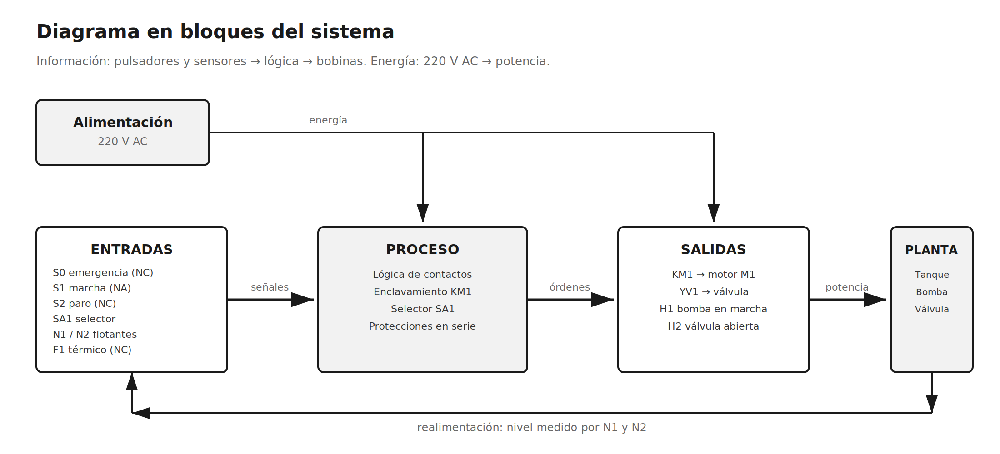
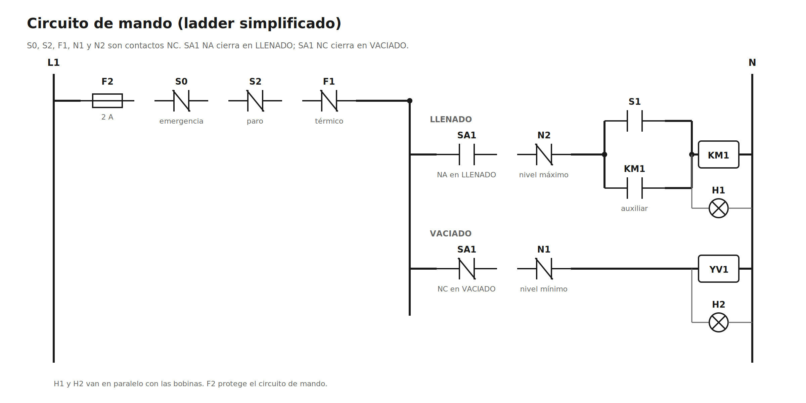
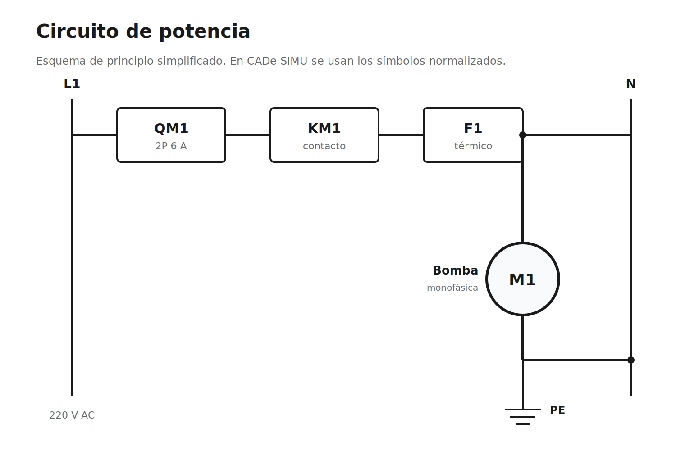

# Estación de llenado y vaciado de tanque

## Trabajo Práctico de Mecatrónica II

*Modelado y simulación de un sistema mecatrónico en CADe SIMU*

---

Universidad Tecnológica Nacional — Facultad Regional Paraná

Tecnicatura Superior en Mecatrónica

Cátedra: Mecatrónica II

Alumno: Hugo Ariel Martinez

Profesor: [completar]

Año: 2026

Fecha: [completar]

*Sistema elegido de la lista de la guía: Sistema de llenado de tanque.*

*Herramienta de simulación: CADe SIMU (en lugar de FluidSIM).*


---


# 1. Descripción del sistema

El sistema que elegí es una estación de llenado y vaciado de un tanque de agua. La función es mantener el nivel entre un mínimo y un máximo: una bomba llena el tanque y una electroválvula lo vacía. Dos flotantes, uno abajo y otro arriba, avisan cuándo se llegó a cada nivel.

La guía lo llama “Sistema de llenado de tanque”. Le agregué el vaciado para poder repetir el ciclo y probar los dos límites. El funcionamiento es simple: con el selector en LLENADO se aprieta MARCHA y arranca la bomba. Cuando el agua llega al flotante de arriba, la bomba se detiene sola. Para vaciar, se gira el selector a VACIADO y se abre la electroválvula. Cuando el nivel baja hasta el flotante de abajo, la válvula se cierra sola. Después se vuelve a LLENADO y se aprieta MARCHA para repetir el ciclo.

Lo elegí porque está en la lista de la guía, es fácil de explicar y se puede resolver con lógica eléctrica de contactos. No necesita neumática, así que lo pude simular completo en CADe SIMU. La parte mecánica es el tanque, la bomba y la válvula; la parte eléctrica es el motor y el contactor; la parte de sensores son los flotantes; y la parte de control es la lógica cableada.

Aplicación: este tipo de sistema se usa en tanques de reserva de agua, en procesos de llenado de mezclas, en riego, en plantas de tratamiento y en cualquier lugar donde haya que mantener un nivel entre dos límites.

Una aclaración sobre la herramienta: la guía pide FluidSIM, pero no tengo licencia. Por eso hice la simulación en CADe SIMU. Elegí un sistema eléctrico para que la simulación sea completa y no quede una parte sin probar. La lógica de contactos, el contactor, el motor y las lámparas se pueden simular bien en CADe SIMU.

| Dato | Descripción |
|---|---|
| Función | Mantener el nivel de un tanque entre un mínimo y un máximo. |
| Alimentación | 220 V AC, monofásica. |
| Control | Lógica cableada con contactor y selector. |
| Protecciones | Interruptor automático QM1, fusible F2 y relé térmico F1. |
| Herramienta | CADe SIMU. |


# 2. Entradas, proceso y salidas

Entradas: son las órdenes del operador y las señales de los sensores. Proceso: es la lógica que decide. Salidas: son los elementos que hacen el trabajo.


## 2.1. Entradas

| Tag | Componente | Contacto | Función |
|---|---|---|---|
| S0 | Pulsador de emergencia | NC | Corta el mando completo. |
| S1 | Pulsador de marcha | NA | Arranca la bomba. |
| S2 | Pulsador de paro | NC | Detiene la bomba y cierra la válvula. |
| SA1 | Selector de 2 posiciones | NA / NC | Elige LLENADO o VACIADO. |
| N1 | Flotante de nivel mínimo | NC | Abre cuando el agua baja del mínimo. |
| N2 | Flotante de nivel máximo | NC | Abre cuando el tanque está lleno. |
| F1 | Relé térmico | NC | Abre si el motor se sobrecarga. |


## 2.2. Proceso

El proceso no tiene PLC. La lógica está hecha con el contactor KM1, su contacto auxiliar y el selector SA1. QM1 protege la alimentación general y F1 el motor. F2 protege el mando, y S0, S2 y F1 están en serie con las bobinas: si alguno se abre, se apagan KM1 y YV1.

Los flotantes N1 y N2 son contactos NC. Esto es a propósito: si se corta un cable o se afloja un borne, el contacto se abre y el sistema queda detenido. Es más seguro que usar contactos NA para las paradas.

*QM1 y F2 no son entradas ni salidas: son protecciones. QM1 protege la instalación y el motor; F2 protege el circuito de mando.*


## 2.3. Salidas

| Tag | Componente | Función |
|---|---|---|
| KM1 | Contactor de la bomba | Da potencia al motor M1. |
| M1 | Motor-bomba monofásico | Llena el tanque. |
| YV1 | Electroválvula de vaciado | Abre el desagüe cuando está energizada. |
| H1 | Lámpara verde | Indica bomba en marcha. |
| H2 | Lámpara roja | Indica válvula de vaciado abierta. |


# 3. Diagrama en bloques



El diagrama muestra cómo se conectan las partes. La energía va de la alimentación a la potencia. La información va de los pulsadores y flotantes a la lógica, y de la lógica a las bobinas.

La alimentación entrega 220 V AC. Las entradas son los pulsadores y los flotantes. El proceso es la lógica de contactos. Las salidas son el contactor, la válvula y las lámparas. La planta es el tanque, la bomba y la válvula.

La realimentación es el nivel del tanque: N1 y N2 le informan a la lógica si el agua está baja o si el tanque está lleno. Sin esos dos sensores, la lógica no sabría cuándo cortar la bomba ni cuándo cerrar la válvula. Ese es el lazo cerrado del sistema.


# 4. Lógica de funcionamiento

Primero escribí la secuencia en palabras y después la pasé a contactos. La idea era que la bomba no dependa de que el operador esté mirando el tanque.


## 4.1. Secuencia

1. Selector en LLENADO, tanque no lleno (N2 cerrado), emergencia sin apretar (S0 cerrado), paro sin apretar (S2 cerrado) y térmico sin disparar (F1 cerrado).
2. Se aprieta S1. Se energiza KM1 y se enclava con su contacto auxiliar. Arranca M1 y se prende H1.
3. El tanque se llena. Cuando el agua llega a N2, el contacto NC se abre. Se desenergiza KM1, se apaga M1 y H1. La bomba queda detenida.
4. Se gira SA1 a VACIADO. Se energiza YV1, se abre la válvula y se prende H2. El tanque se vacía.
5. Cuando el agua baja hasta N1, el contacto NC se abre. Se desenergiza YV1, se cierra la válvula y se apaga H2.
6. Se vuelve a LLENADO y se aprieta S1 para repetir el ciclo.

Si se aprieta S0 o S2, o si dispara F1, se corta el mando y se apagan KM1 y YV1. La válvula es normalmente cerrada: sin tensión queda cerrada.


## 4.2. Variables y ecuaciones

Para escribir las ecuaciones usé 1 cuando el contacto está cerrado y 0 cuando está abierto.

| Variable | Significado | Vale 1 cuando... | Vale 0 cuando... |
|---|---|---|---|
| S0 | Emergencia | No está apretada (NC cerrado) | Está apretada (abierto) |
| S1 | Marcha | Está apretada (NA cerrado) | No está apretada (abierto) |
| S2 | Paro | No está apretado (NC cerrado) | Está apretado (abierto) |
| SA1 | Selector | Está en LLENADO | Está en VACIADO |
| N1 | Flotante mínimo | Nivel sobre el mínimo (NC cerrado) | Nivel en el mínimo (abierto) |
| N2 | Flotante máximo | Tanque no lleno (NC cerrado) | Tanque lleno (abierto) |
| F1 | Térmico | Normal (NC cerrado) | Disparado (abierto) |

```
KM1 = F2 · S0 · S2 · F1 · SA1 · N2 · (S1 + KM1)
YV1 = F2 · S0 · S2 · F1 · SA1' · N1
H1  = KM1
H2  = YV1
```

SA1' es el contacto NC del selector, que está cerrado en VACIADO.

- **F2 · S0 · S2 · F1** es la cadena de seguridad. Si cualquiera se abre, KM1 y YV1 se apagan.
- **SA1** deja pasar el mando solo en LLENADO. **SA1'** deja pasar solo en VACIADO. Por eso la bomba y la válvula no pueden funcionar juntas.
- **N2** está cerrado mientras el tanque no está lleno. Cuando se abre, corta KM1.
- **(S1 + KM1)** es el enclavamiento. S1 arranca y KM1 se mantiene solo; cuando N2 se abre, se pierde el enclavamiento y hay que volver a apretar S1.
- **N1** está cerrado mientras hay agua por encima del mínimo. Cuando se abre, corta YV1 y evita que la válvula quede abierta con el tanque vacío.


## 4.3. Ladder

El circuito de mando queda así:

| Estado | SA1 | N1 | N2 | KM1 | YV1 | Qué pasa |
|---|---|---|---|---|---|---|
| Reposo | LLENADO | 1 | 1 | 0 | 0 | Espera S1. |
| Llenando | LLENADO | 1 | 1 | 1 | 0 | Bomba en marcha. |
| Lleno | LLENADO | 1 | 0 | 0 | 0 | N2 corta la bomba. |
| Vaciando | VACIADO | 1 | 0/1 | 0 | 1 | Válvula abierta. |
| Mínimo | VACIADO | 0 | 1 | 0 | 0 | N1 cierra la válvula. |
| Emergencia | — | — | — | 0 | 0 | Todo apagado. |

*En la tabla, 1 significa contacto cerrado y 0 contacto abierto. En el estado LLENADO, si el operador no gira el selector, la bomba queda detenida con el tanque lleno.*




# 5. Simulación en CADe SIMU


## 5.1. Circuito de potencia



Primero armé la potencia y la probé con el motor solo. Después agregué el mando. Así, si algo no andaba, sabía si el problema estaba en la potencia o en la lógica. Perdí un rato con el contacto auxiliar de KM1 porque al principio no lo había puesto y la bomba se apagaba al soltar S1. Después entendí que el contacto auxiliar hace el enclavamiento.

El circuito de potencia es: L1 → QM1 → KM1 → F1 → M1 → N. QM1 protege la instalación, KM1 da paso a la bomba y F1 protege el motor contra sobrecarga. El motor es monofásico de 220 V.


## 5.2. Circuito de mando

El circuito de mando se alimenta de L1, después de QM1: L1 → F2 → S0 → S2 → F1 → ramas. La rama de LLENADO tiene SA1 NA, N2 NC, el paralelo S1/KM1 y la bobina KM1. La rama de VACIADO tiene SA1 NC, N1 NC y la bobina YV1. H1 va en paralelo con KM1 y H2 con YV1.

La bobina de KM1 y la de YV1 son de 220 V AC. Las lámparas también. En una instalación real convendría usar mando a 24 V, pero para la simulación lo hice a 220 V para no agregar una fuente.


## 5.3. Componentes usados

| Componente en CADe SIMU | Tag | Detalle |
|---|---|---|
| Alimentación F+N | — | 220 V AC |
| Interruptor automático 2P | QM1 | 6 A |
| Fusible | F2 | 2 A, circuito de mando |
| Contactor 2P con auxiliar NA | KM1 | Bobina 220 V AC |
| Relé térmico | F1 | Regulado a 2 A |
| Motor monofásico | M1 | Bomba de 0,5 HP |
| Pulsador NC | S0 | Emergencia tipo seta |
| Pulsador NA | S1 | Marcha |
| Pulsador NC | S2 | Paro |
| Selector 2 posiciones | SA1 | LLENADO / VACIADO |
| Final de carrera NC | N1 | Flotante de nivel mínimo |
| Final de carrera NC | N2 | Flotante de nivel máximo |
| Bobina de electroválvula | YV1 | 220 V AC, normalmente cerrada |
| Lámpara verde | H1 | 220 V, bomba en marcha |
| Lámpara roja | H2 | 220 V, válvula abierta |


## 5.4. Pasos de armado

1. Abrir CADe SIMU y configurar hoja A4 horizontal. Completar el cajetín con nombre, materia y fecha.
2. Colocar la alimentación F+N, el interruptor QM1 y el fusible F2.
3. Armar la potencia: QM1 → KM1 → F1 → M1 → N. Conectar PE al motor.
4. Armar la cadena de mando: F2 → S0 NC → S2 NC → F1 NC.
5. Rama de LLENADO: SA1 NA → N2 NC → (S1 NA en paralelo con KM1 NA) → bobina KM1 → N.
6. Rama de VACIADO: SA1 NC → N1 NC → bobina YV1 → N.
7. Conectar H1 en paralelo con KM1 y H2 en paralelo con YV1.
8. Etiquetar todos los componentes y verificar que no haya dos con el mismo nombre.
9. Guardar el archivo como TP_Llenado_Tanque.cad.
10. Pasar a modo simulación y probar la secuencia.

Detalles que me complicaron en CADe SIMU:

- Los pulsadores vuelven solos. Para mantenerlos apretados hay que hacer clic y arrastrar un poco.
- Los finales de carrera N1 y N2 son NC: en la simulación se hace clic para abrirlos y representar el flotante actuado.
- Si dos componentes tienen el mismo nombre, la simulación no funciona. Hay que renombrarlos.
- El contactor KM1 necesita un contacto auxiliar NA para el enclavamiento. No alcanza con la bobina.


## 5.5. Pruebas

Antes de entregar voy a probar estos casos. La columna Resultado la completo después de simular.

| N.º | Prueba | Acción | Resultado esperado | Resultado (completar) |
|---|---|---|---|---|
| 1 | Marcha | Apretar S1 | KM1 y M1 en marcha; H1 encendida. |  |
| 2 | Paro | Apretar S2 | KM1 y M1 se detienen; H1 apagada. |  |
| 3 | Tanque lleno | Abrir N2 | KM1 se detiene; H1 apagada. |  |
| 4 | Vaciado | SA1 en VACIADO | YV1 se energiza; H2 encendida. |  |
| 5 | Nivel mínimo | Abrir N1 | YV1 se desenergiza; H2 apagada. |  |
| 6 | Emergencia | Apretar S0 | Todo se apaga. |  |
| 7 | Térmico | Disparar F1 | Todo se apaga. |  |
| 8 | Enclavamiento | Apretar S1 y soltar | KM1 queda encendido. |  |
| 9 | Interlock | SA1 en VACIADO + S1 | La bomba no arranca. |  |
| 10 | Repetición | N1 abierto, SA1 en LLENADO, S1 | La bomba vuelve a arrancar. |  |

*Las capturas de pantalla de las pruebas están en el Anexo B.*


# 6. Demostración y conclusión


## 6.1. Guion de la demostración

1. Mostrar el esquema y explicar los bloques: entradas, proceso, salidas y realimentación.
2. Arrancar la bomba con S1 y mostrar H1.
3. Simular el tanque lleno abriendo N2 y mostrar que la bomba se detiene.
4. Girar el selector a VACIADO y mostrar H2 y la válvula.
5. Simular el nivel mínimo abriendo N1 y mostrar que la válvula se cierra.
6. Probar S0 y mostrar que todo se apaga.
7. Explicar por qué usé CADe SIMU y no FluidSIM.

Tiempo estimado: 3 minutos.


## 6.2. Conclusión

Lo que más me costó fue separar la potencia del mando. Al principio quería poner los flotantes en serie con el motor, pero me di cuenta de que así el contacto del flotante corta la corriente del motor con carga y no es lo correcto. La solución fue poner los flotantes en el circuito de mando, que maneja la bobina del contactor.

También aprendí a usar un contacto auxiliar para el enclavamiento y a poner las protecciones en serie. El sistema quedó simple pero completo: arranca, se detiene solo cuando el tanque está lleno, se vacía y se cierra cuando llega al mínimo.

No automaticé el vaciado: hay que girar el selector. Lo dejé así para que el circuito sea fácil de entender. Una mejora posible sería agregar un relé de memoria que abra la válvula cuando N2 se active y la cierre cuando N1 se active. Otra mejora sería usar mando a 24 V y agregar un piloto de tanque lleno.

Usé CADe SIMU porque no tengo FluidSIM. La parte eléctrica se puede simular completa y el sistema no necesita neumática. Si la cátedra pide FluidSIM, se podría hacer una variante neumática, pero para este sistema no hace falta.


# Anexo A. Lista de materiales

- Tanque de 100 L con base y desagüe.
- Bomba monofásica de 0,5 HP, 220 V.
- Electroválvula normalmente cerrada de 1/2", 220 V.
- Dos flotantes NC (nivel mínimo y nivel máximo).
- Tablero con QM1, F2, KM1, F1, S0, S1, S2, SA1, H1, H2, borneras y cables.


# Anexo B. Capturas

Acá van las capturas de CADe SIMU. La primera muestra la bomba en marcha y la segunda la válvula de vaciado abierta.

> **[PLACEHOLDER]** Captura 1: bomba en marcha (pegar captura de CADe SIMU)

> **[PLACEHOLDER]** Captura 2: válvula de vaciado abierta (pegar captura de CADe SIMU)


# Anexo C. Cosas que corregí

- Primero puse N2 en el circuito de potencia. Mal: el contacto del flotante no está pensado para cortar el motor. Lo pasé al circuito de mando.
- Me olvidé del contacto auxiliar de KM1 y la bomba arrancaba solo mientras tenía apretado S1. Agregué el NA en paralelo.
- Usé un solo contacto del selector y la válvula se abría también en LLENADO. Lo corregí usando NA para LLENADO y NC para VACIADO.
- Al principio las lámparas estaban en serie con las bobinas. Las puse en paralelo.
